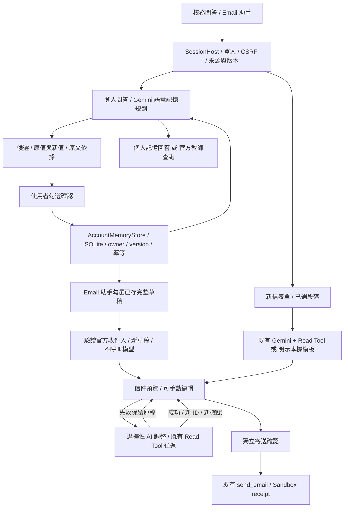

# Week 07 — Account-scoped Memory

更新：2026-10-29（Asia/Taipei）。延續「Making Life at NUTN Better with Agents」，選擇 **A 路線：保存、讀回、更正及撤回已確認內容**。

- Repository：[campus_chatbox](https://github.com/anyi-lee/nutn-agent-2026f-teamNN-campus_chatbox)
- Baseline SHA：`6bbd34f369a40b5a2a46534e881197bddfcfea01`
- Candidate：`WORKING_TREE`；尚未 commit／push，程式指紋見本次 metadata，不以 HEAD 冒充候選版本。
- 本週驗收：`WEEK07_OFFLINE_PASS`，68／68 Python（含 2 項真實 localhost HTTP）及 22 組 JS VM PASS。
- 跨週非 HTTP 回歸：137 項，130 PASS、7 項缺少選配 LangChain 依賴 skipped；與本週驗收有重疊，不加總成測試數。
- 真實模型：`LIVE_NOT_RUN`；課程 ADC、瀏覽器視覺／錄影尚未驗證；真實寄信 `false`。

## 本週目標與選擇理由

學生反覆輸入自介、署名、相同信件，以及「哪位老師教我的哪門課」。原版只有短期教師脈絡，不能跨對話讀回本人確認的資訊。本週沿用原介面與工具，新增帳號隔離的長期記憶，讓使用者在同一任務內保存、重用及更正。

記憶分為常用文字、完整草稿與校務問答的個人事實。模型處理自然語意及可選的信件潤稿；一般程式處理帳號、來源查核、schema、版本、權限、確認與冪等。沒有新增 embedding 或多 Agent 框架。原教師 context 清除是支援控制，不另宣稱完成 C 路線；B 事件問答與 D 角色共享不在範圍。

課程依據為 `Lecture07_Agentic_AI_Engineering_Agent_Memory_Architectures.pdf` 實際頁序 78、80–81、85–88（共 89 頁；SHA-256：`83f4370071aa373a260f248fd5f9d5caec45547ce95c868ec4ef85aea50e7e9b`）。交付結構延續 W06 的 README／ADR／Before-After／Evidence Index，再附驗收矩陣及提交檢核。課程 PDF 不隨 Repository 提交。

## 功能與主流程

| 記憶／狀態 | 寫入與讀回 | 狀態 |
| --- | --- | --- |
| 常用文字 | 登入後確認保存自介／詢問／署名等段落；新信表單勾選、預覽並確認套用 | 已實作，離線及 HTTP 驗證 |
| 完整草稿 `draft_template` | 由本人有效草稿另存教師、主旨、正文；Email 助手上方勾選即建立新草稿，重新查官方收件人 | 已實作，離線及 HTTP 驗證 |
| 個人事實 `personal_fact` | Gemini 依語意提出候選、查用或同義更正；使用者勾選確認後保存／覆蓋，使用時顯示個人來源 | 已實作；模型契約以離線替身驗證，真實語意準確率未驗證 |
| 待處理的 Email 畫面 | 同頁面、同身分關閉再開可續編；未確認修改及 AI 指示保留 | 已實作，JS VM 驗證；不跨重新整理／重啟 |
| AI 調整 | 本人 canonical 草稿＋本次指示；成功換新草稿 ID，重新確認寄送；失敗保留來源稿及介面 | 已實作，離線故障注入驗證；真實 Gemini 待驗證 |



已移除公版、表單保存及管理清單的引用入口。來源與收件人仍由官方資料決定；保存記憶不代表授權寄信。

## 記憶決策與版本紀錄

記憶分層、保存／清除時機、選擇原因、原版／候選差異、驗收與代價已合併在 [W7 記憶決策與版本紀錄](memory_adr.md)，比照 W05 的決策紀錄方式集中維護。本頁保留啟動、操作及主流程入口。

分類依 PPT：工作、事件、語意、程序是內容角色，短期／長期是保存期間，context 是本輪模型實際收到的內容。W7 主要新增確認後的長期個人語意記憶及可重用內容，仍選 A 路線；UI 任務暫存不是持久 checkpoint，未傳入模型的資料也不直接稱為工作記憶。完整對應、適用原因及前後差異集中於版本紀錄。

## 保留、替換、轉接及新增

| 類別 | 本次邊界 |
| --- | --- |
| 保留 | 官方快照、BM25／Dense Stub、Evidence Gate、W05 manual／LangChain 切換、W06 routing、Read Tool、Sandbox Write 與確認／冪等 |
| 替換 | 前端自帶教師脈絡改由後端 session 解析；共享 HTTP 邊界須帶 session／CSRF，不能宣稱零介面影響 |
| 轉接 | `CampusService` 接受後端已驗證的選取內容；模型提示將私人文字當成資料；UI 顯示工具、來源、記憶及失敗狀態 |
| 新增 | `AccountMemoryStore`、`SessionHost`、`GeminiPersonalMemoryPlanner`、登入與記憶 API、草稿重用／更新／AI 調整及對應測試 |

本頁架構圖呈現 W7 的實際流程；選擇理由、修改範圍及前後比較統一見 [記憶決策與版本紀錄](memory_adr.md)，開頭附 ADR 摘要。

## 啟動與操作

```powershell
Set-Location "C:\Users\rice106\Desktop\Agentic\campus-chatbox-review"
$env:EMAIL_AGENT_BACKEND = "manual"
$env:CHAT_WORKFLOW_BACKEND = "baseline"
python app.py
```

開啟 `http://127.0.0.1:8000`。更新後需重新啟動後端，再按 Ctrl+F5。訪客仍可查詢及建立草稿；保存／讀回私人內容需登入。帳號 3–32 個英數字、底線或連字號，密碼 12–128 字；沒有預設帳密，也不是學校 SSO。

要驗證真實 Gemini，先在啟動服務的同一個 PowerShell 設定 Key，再啟動：

```powershell
$geminiKey = Read-Host "Gemini API Key" -AsSecureString
$env:GEMINI_API_KEY = [System.Net.NetworkCredential]::new("", $geminiKey).Password
python app.py
```

登入問答即使用 Gemini 記憶語意規劃，與 `baseline`／`routing` 聊天開關分開；每次登入問答增加一次模型請求。Key 不寫入 Repository。上述目前是 Gemini Developer API Key 接法，不能當成期中要求的 Google Cloud／ADC。

- 正常示範：登入→問答「微積分老師是林朝興」→勾選確認→新對話「找微積分老師」→查官方研究領域。姓名與課程關係請使用合成資料，不聲稱是真實任課資訊。
- 路線邊界：提供同一課程的新教師→檢查舊值／新值→勾選覆蓋→新對話查用新值；另一帳號不可讀取。未知官方教師要停止釐清。
- Email 示範：建立新信→另存完整草稿→助手上方勾選重用→可手動或 AI 調整→檢查全文→獨立確認 Sandbox。

細節：[個人語意記憶](personal_memory.md)、[草稿操作](template_manual_test.md)。

## 重現驗收與證據

```powershell
python -W error::ResourceWarning scripts/run_week07_validation.py
python scripts/run_personal_memory_validation.py
python -W error::ResourceWarning scripts/run_week07_memory_demo.py
```

前者執行本週 68 項 Python／HTTP 與 22 組 JS VM；第二個執行 137 項非 HTTP 跨週回歸及相同 JS VM；第三個是合成資料的 in-process 示範。都不呼叫真實 Gemini，不寄真實郵件。

本週 run ID：`week07-069fc5f5d0174cf1bfd884529f1641ad`。最新結果：[驗收矩陣](acceptance.md)、[證據索引](evidence_index.md)、[提交檢核](submission_checklist.md)。

## 失敗、停止及限制

- 未登入、跨帳號、舊版本、已撤回、未確認或無效操作 ID 均拒絕；模型完成後重驗記憶與 session，避免舊結果回填。
- 模型未設定／失敗分開標示；記憶理解降級基本比對，AI 調整不以本機模板冒充成功。錯誤保留草稿及可取得的遮蔽後原因。
- AI 調整須保留來源稿可辨識的中文署名；更改姓名先手動編輯來源。不含可辨識署名的原稿仍需人工檢查，未宣稱有通用身分驗證。
- 每帳號最多 100 筆；常用文字／手動個人記憶最多 2000 字，整封草稿正文 4000 字；語意候選值最多 200 字。Email 一次最多 8 筆／合計 4000 字。
- 私人 SQLite 持久保存至刪除；session、未確認候選與草稿綁定不跨程序恢復。關閉助手可續編，重新整理不保證恢復；SQLite 刪除不代表備份或磁碟歷史安全抹除。
- W7 真實 Gemini、ADC、視覺／備用錄影及 tokens／Live latency 未驗證。歷史 W04–06 Live 不移作本週證據。未 commit／push、教師遠端存取及組員貢獻待補，見提交檢核。
