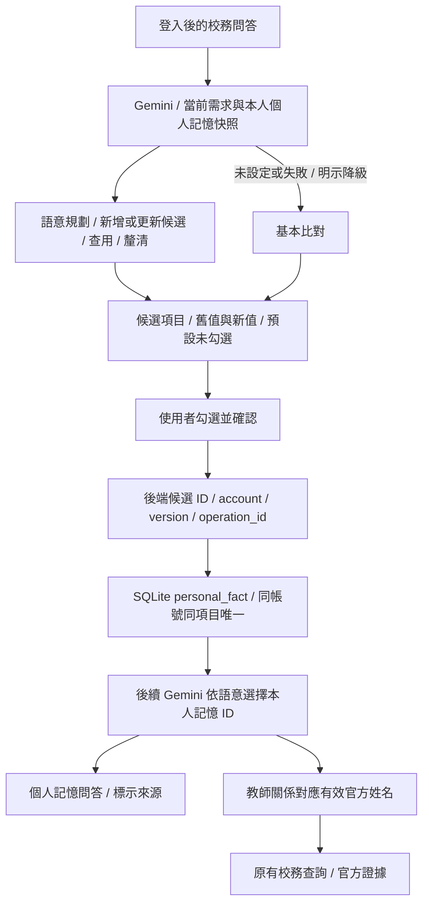

# 校務問答的個人記憶

更新：2026-10-29；candidate `967ee1ef8e484a41250688474dbcaba7c3139896`。擴充既有帳號記憶，不替換原教師檢索、模型／工具往返或 Email 草稿流程。

## 手動驗收

沿用啟動 Email Gemini 的 `GEMINI_API_KEY`／`GEMINI_MODEL` 環境設定，停止服務並重新執行 `python app.py`，瀏覽器 Ctrl+F5，登入後於校務問答操作。即使 `CHAT_WORKFLOW_BACKEND=baseline`，登入後也會獨立執行 Gemini 記憶語意規劃；每次問答增加一次模型請求。未設定或失敗時明示降級為基本比對。

1. 輸入「微積分老師是林朝興」或「這學期微積分給林朝興教，幫我記一下」。回答下方列出候選及原文依據，預設未勾選、尚未寫入。
2. 勾選並按「確認加入／覆蓋勾選的記憶」。
3. 問「找微積分老師」「微積分要找哪位？」或「教我微積分的是誰」。應以個人記憶回答，不冒用官方引用。
4. 問「教我微積分的老師做哪方面研究」。應將個人關係對應到有效官方姓名，改寫查詢後走原查詢與引用。
5. 輸入「微積分換成另一位合成教師教了」。Gemini 應判斷為同一事實的更正；候選顯示原值、新值，確認後沿用原 memory_id、title，version 增加，舊值被覆蓋。
6. 再問教師是誰應回答新值；查未知教師的官方研究領域時停止並要求更正，不沿用上一位教師。
7. 新對話、登出登入、服務重啟登入後，確認過的記憶仍存在。未確認候選不持久保存。
8. 「常用內容」可修改／刪除「個人記憶」紀錄。另一帳號與訪客不能讀取或保存本人的記憶。

示例為合成個人關係，不宣稱該教師真的教授微積分。

## 架構與界線

- Gemini 依語意判斷 remember／recall／campus_query／none／clarify，並提議新增或覆蓋既有項目；不要求固定句式。不從模型回答捏造使用者事實，寫入仍需使用者確認。
- 傳入模型的資料限當前訊息與本人 `personal_fact` 的 ID、title、content、version，不傳帳密、Cookie、CSRF、私人 Email 範本或其他帳號資料。網路工作不持有 session 鎖，新對話／換身分可使舊模型回覆失效。
- 模型輸出須符合 JSON schema；記憶 ID 必須屬於帳號快照。候選需附使用者當前訊息中的逐字 evidence_quote，值須出現在引文中；常見憑證欄位拒絕。語意不明用 clarify；候選內容與舊值交由使用者檢查。
- 未設定模型／API 錯誤／輸出驗證失敗時回基本比對並顯示狀態，不冒稱語意成功。基本比對支援省略「我的」，包含「微積分老師是林朝興」「找微積分老師」；其他複雜改述需 Gemini。狀態分 LIVE_NOT_RUN、LIVE_FAIL、LIVE_PASS；離線替身另標 offline_model_double。
- 沿用 SQLite，新增 kind `personal_fact`；title 為正規化項目、content 為值。有效紀錄以 account_id + title 唯一，不影響其他文字或草稿模板。
- 只列候選不寫入。session 內保存最近 64 個候選，新對話、換身分、來源失效或重啟會清除。保存 API `/api/personal-memory/save` 只採信後端候選內容，驗證登入、CSRF、session、明確確認、預期版本及操作冪等。
- 覆蓋需符合候選顯示時的版本，並行修改回 409 要求重新確認。網路失敗重試沿用 operation_id，避免重複寫入。
- 讀回由模型選擇相關記憶 ID，無 embedding；後端只從已保存內容組裝個人答案。教師關係仍核對有效官方全名，才採用模型改寫查詢；使用者當前明確指定的其他教師優先。模型完成後重新檢查記憶版本，並行更正時停止舊回覆。
- 語意規劃不能自行刪除或直接改資料，也不提供模型寫入權限；模型負責理解及提出維護方案，既有 SQLite／owner／version／operation_id 和使用者確認負責執行。
- 使用記憶時標示項目、值及非官方來源。教師信箱與研究領域仍以官方資料為準，未知教師停止。
- 個人記憶不出現在 Email 常用段落選單；後端也拒絕將此類直接當作信件段落套用。

## 驗證

`python scripts/run_personal_memory_validation.py`：137 項 Python 回歸，130 PASS、7 項因未安裝 LangChain 依賴 skipped；22 組 JS VM PASS。明確排除兩項 HTTP server 測試，不呼叫真實 Gemini。12 項個人記憶測試與 14 項語意規劃測試涵蓋自然說法、同義更正、官方查詢、未知 ID／捏造值拒絕、模型失敗降級、重設競態、版本重驗、隔離、持久化與冪等。語意測試使用明示的模型替身及 transport spy，不能當成真實模型語意準確率。

[metadata](../../evidence/week07_personal_memory.json)、[Python log](../../evidence/week07_personal_memory_offline.log)、[JS VM log](../../evidence/week07_personal_memory_ui.log) 記錄日期與程式指紋。首次沙盒暫存目錄權限失敗另保留於 `week07_personal_memory_sandbox_attempt` 紀錄；獲准重跑後通過。真實 Gemini 為 LIVE_NOT_RUN，瀏覽器視覺未驗證。
